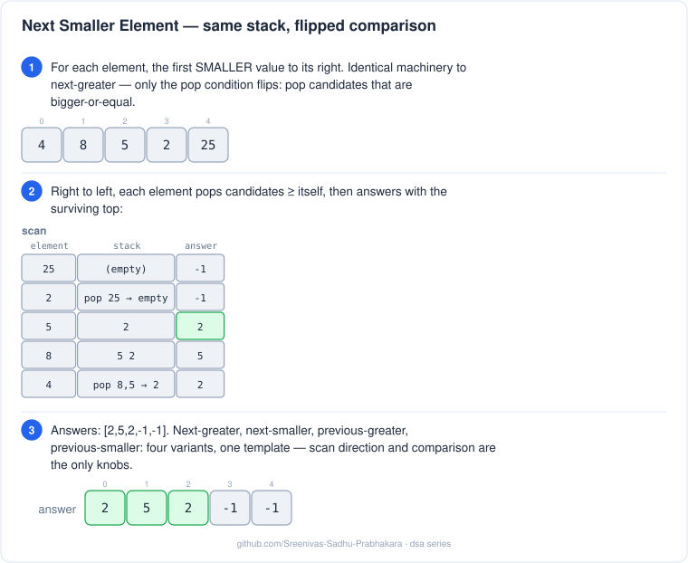

# Next Smaller Element

> Striver SDE Sheet 082 · Day 14 Stack & Queue II — next-greater's mirror: the same unresolved-index stack, one comparison flipped. Go, stdlib only, tested.

## Problem

For each element, the first strictly smaller element to its right (-1 if none).

## Approach

Identical machinery to Next Greater Element with the inequality reversed: the waiting stack now keeps values in *increasing* order downwards, and each newcomer resolves every larger value above it. The reason this gets its own sheet slot despite being a one-character diff: next-smaller-to-the-left and -right are the exact subroutines that power the largest-rectangle-in-histogram and max-of-minimums problems that follow — knowing the mirror cold is prerequisite plumbing.

**Complexity:** O(n) time, O(n) space.

## Visual walkthrough

Read the picture top to bottom — each numbered frame is one moment of the algorithm
running on this repo's test example.

## Run

    go test ./...   # verify
    go run .        # demo

---

One of 191 repos solving Striver's SDE Sheet in Go — stdlib only, one problem per repo, every solution tested. Browse the set: [`dsa-*` repos](https://github.com/Sreenivas-Sadhu-Prabhakara?tab=repositories&q=dsa-&type=source).
